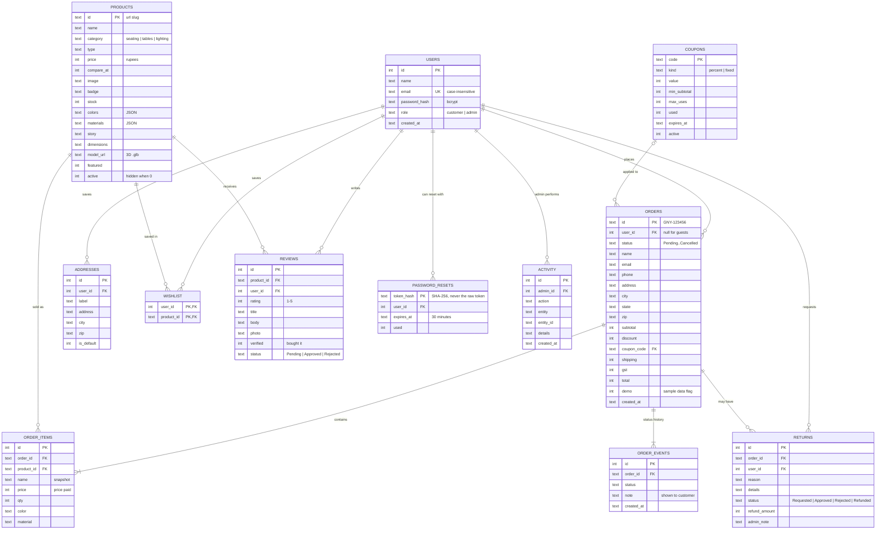

# Database design

SQLite database (`data/gany.db`), created and migrated automatically by [`server/db.js`](../server/db.js) on start-up. GitHub renders the diagram below.

Two standalone tables are not shown: `messages` (contact form) and `subscribers` (newsletter).

## Design decisions

- **Order items copy the product's name, image and price.** Later edits to the catalogue never change what an old order or invoice shows.
- **Stock is reserved inside the order transaction** (`UPDATE … SET stock = stock - ? WHERE stock >= ?`), so two people can't buy the last item at the same time. Cancelling or refunding puts it back.
- **Products with orders are hidden, not deleted**, so order history and reviews stay intact.
- **Password reset tokens are stored hashed**, are single-use and expire after 30 minutes.
- **Sample orders are flagged `demo = 1`.** They never touch real stock and can be removed in one click.
- **Money is stored as whole rupees (integers)** to avoid floating-point rounding.
